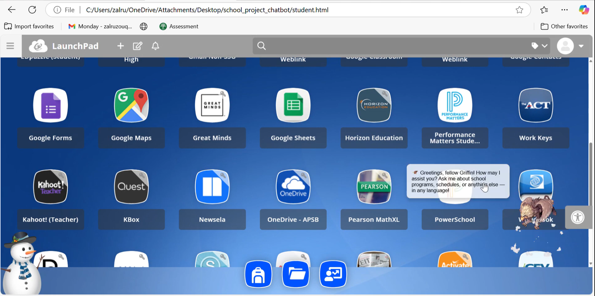
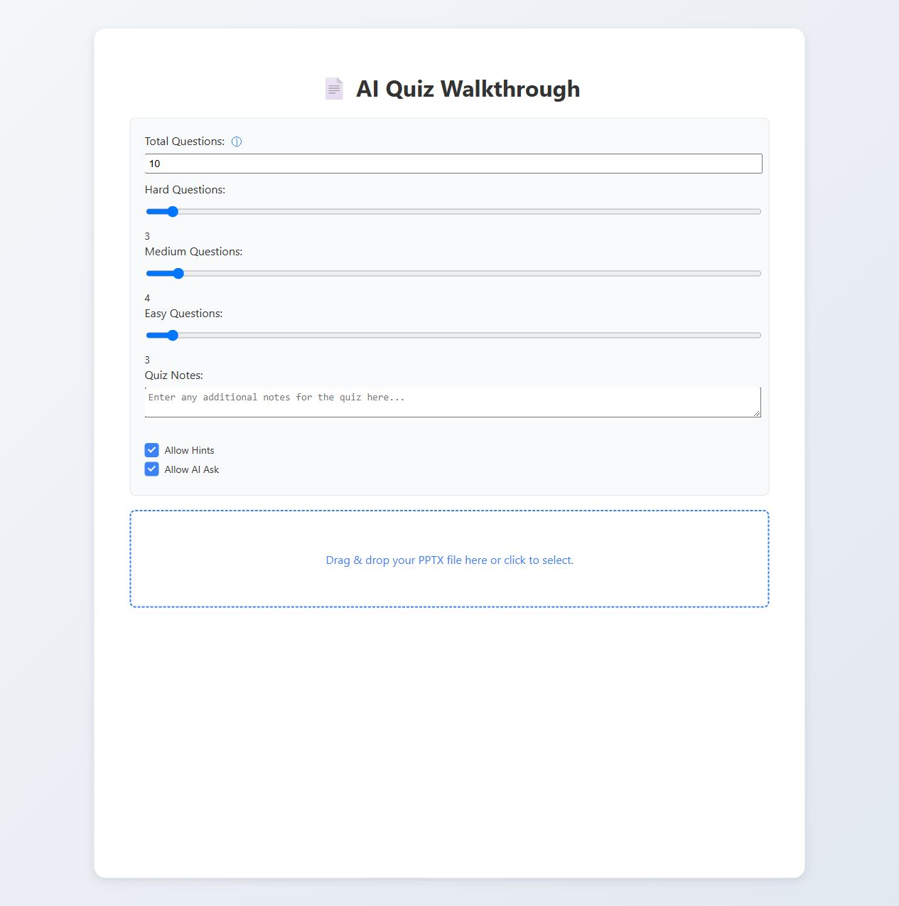

# AI Educational Tools

Ask the Griffin chatbot about school clubs or schedules, or turn a PowerPoint into a practice quiz. These are two separate classroom prototypes.

| Tool | What you can do | Where to look |
| --- | --- | --- |
| **School Chat** | Ask a school question or switch to the student view for answers based on a Google Sheet. [Watch the demo](https://drive.google.com/file/d/1jBKHtJOBXWiduUyuQH9H6FIf7EdXkjUK/view?usp=sharing) | [chatbot/](chatbot/) has the Node server. [chatbot/web/](chatbot/web/) has the role picker and both chat screens. |
| **PowerPoint to Quiz** | Pick slides, set the difficulty, answer questions, and ask for a hint. | [quiz/](quiz/) has the Python API and dependencies. [quiz/web/](quiz/web/) has the upload and quiz screen. |

The pages open locally for a preview. To generate answers or quizzes, start the matching backend and set up Gemini. The student view also needs Google Sheets, and slide previews use PowerPoint on Windows. [Setup instructions](SETUP.md)

## Screenshots

**School chat**

**Quiz setup**

